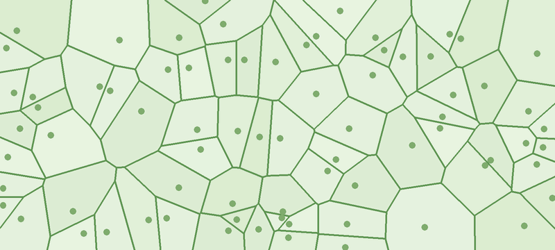

# cellyod — génération de tissus cellulaires



cellyod pave un domaine par un diagramme de Voronoï, régularisé par des itérations de Lloyd. Une fraction des
germes peut être des **bundles** (faisceaux vasculaires) qui attirent les autres cellules au sens d'une distance
de Mahalanobis : on obtient alors des tissus végétaux, du pavage hexagonal régulier aux tissus très hétérogènes
organisés en colonnes (modèle de Trivino *et al.*, *A continuous description of plant cellular tissues from
variational Voronoi morphogenesis*).

C++17, sans dépendance pour le cœur et la ligne de commande. L'interface graphique dépend en plus de raylib
(`brew install raylib`) ; raygui et rini (single-header) sont fournis dans `gui/`.

```bash
make                         # -> cellyod et cellyod-gui
make cellyod                 # ligne de commande seule (sans raylib)
cd examples
../cellyod tissu.txt         # -> tissu_cells.txt + tissu.svg
../cellyod tissu.txt alpha=0.1 "anisotropy=1000 90" svg=none
../cellyod -load tissu_cells.txt lloydIterations=100   # reprend les itérations là où elles s'étaient arrêtées
../cellyod -h                # liste des paramètres
```

Toutes les grandeurs sont **sans dimension** : l'unité de longueur est le diamètre équivalent visé des cellules.
Une cellule a donc une aire visée de π/4, et un domaine `Lx × Ly` contient environ `Lx·Ly/(π/4)` cellules.

## Forme du domaine

Les germes remplissent toujours le rectangle `[0, Lx] × [0, Ly]`. Le tissu est la partie de ce rectangle où
`f(x, y) ≤ 0`, f étant donnée par l'expression `shape` (sans `shape` : tout le rectangle) :

- une cellule coupée par le bord de la forme est réduite à sa partie intérieure ; le bord courbe est suivi
  finement (points de passage par dichotomie, puis projection sur f = 0) ;
- une cellule entièrement extérieure est vide et son germe reste **immobile** : les germes extérieurs forment la
  paroi qui contient le tissu ;
- une cellule coupée va vers le centroïde c de sa partie intérieure, en
  p' = (c + α b + w c)/(1 + α + w), avec w = `beta` × (aire extérieure). Avec `beta` grand (défaut 10⁶),
  elle suit Lloyd sans être attirée par les bundles ; les cellules entièrement intérieures ne sont pas
  concernées.

Le rectangle doit déborder un peu de la forme (une ou deux cellules) pour qu'il y ait des germes extérieurs.

Expression : opérateurs `+ - * / ^`, parenthèses, fonctions `sin cos tan asin acos atan exp log sqrt abs
floor ceil` et `atan2(y, x) min(a, b) max(a, b) pow(a, b)`, constantes `pi` et `e`. Variables : `x`, `y`, `r` et
`t` (rayon et angle en radians depuis le centre du rectangle), `cx`, `cy` (centre), `Lx`, `Ly`. Union de deux
formes : `min(f1, f2)` ; intersection : `max(f1, f2)` ; différence : `max(f1, -f2)`.

| Forme | `shape` |
|---|---|
| disque de rayon 18 | `r - 18` |
| ellipse de demi-axes 20 et 12 | `((x-cx)/20)^2 + ((y-cy)/12)^2 - 1` |
| rectangle centré 30 × 16 | `max(abs(x-cx) - 15, abs(y-cy) - 8)` |
| anneau | `max(r - 18, 8 - r)` |
| disque échancré (`examples/rein.txt`) | `r - 20 + 4.5*exp(-t^2/0.12)` |

## Documentation

Un tutoriel détaillé (utilisation, méthode, fichiers, interface, organisation du code) est dans
`doc/tutorial_cellyod.tex`. Seules les sources sont versionnées ; pour produire le PDF (inkscape, ImageMagick et
LuaLaTeX nécessaires) :

```bash
cd doc && ./make_figures.sh && latexmk -lualatex tutorial_cellyod.tex   # -> doc/tutorial_cellyod.pdf
```

## Interface graphique

```bash
./cellyod-gui                          # paramètres par défaut
./cellyod-gui examples/tissu.txt       # fichier de paramètres ou de cellules
```

Le tissu évolue en direct, itération par itération. Le panneau de droite est découpé en sections
**repliables** (clic sur l'en-tête, y compris pour chaque groupe de paramètres ; l'état est mémorisé) :

- **Simulation** : lancer/pause, une itération, régénérer, calcul direct jusqu'à `lloydIterations`, arrêt
  automatique à `lloydIterations`, nombre d'itérations par image ;
- **Paramètres** : tous les paramètres du registre, avec un curseur et une valeur modifiable au clavier (cliquer
  sur la valeur, Entrée pour valider). Un paramètre marqué `*` régénère les germes ; les autres (`alpha`,
  anisotropie, `bundleMotion`, `lloydIterations`) s'appliquent dès l'itération suivante, sans repartir de zéro.
  L'aide d'un paramètre s'affiche dans la barre d'état quand la souris le survole. L'expression `shape` se
  saisit dans un champ (Entrée pour valider ; une expression invalide est signalée dans la barre d'état) ;
- **Affichage** : rendu uniforme (parois, germes gris cerclés, bundles en rouge, comme le SVG), ou coloration
  par nombre de côtés, par aire ou par indice de forme ; germes, bundles et parois affichés ou non ; thème **noir sur blanc** (défaut)
  ou **blanc sur noir**, également appliqué au SVG enregistré. Le bord du tissu est tracé en trait épais ;
- **Métriques** : valeurs courantes ; un clic sur une métrique trace son évolution en fonction de l'itération ;
  histogramme du nombre de côtés ;
Les actions moins fréquentes sont dans des **fenêtres surgissantes**, ouvertes depuis la barre en haut du
panneau (Échap pour fermer) :

- **Fichiers...** (touche E) : enregistrer ou charger un fichier de cellules (ou de paramètres) ; exporter le SVG
  (nom, germes, bundles, largeur en pixels, thème) ; capturer la vue en PNG ; exporter un polygone par cellule
  avec décalage des parois ; exporter les paramètres
  (`<nom>_params.txt`, relisible par `cellyod`). Un fichier de cellules ou de paramètres peut aussi être
  glissé-déposé dans la fenêtre ;
- **Préférences...** : taille de police, largeur du panneau ;
- **Aide...** (touche H) : clavier, souris, panneau.

Dans la vue : clic gauche sur une cellule pour en faire un bundle (ou l'inverse), glisser pour déplacer, molette
pour zoomer. Les bundles ajoutés à la souris sont mémorisés comme bundles imposés (`bundle x y`) : ils sont
gardés à la régénération et enregistrés avec les paramètres.

Clavier : Espace lancer/pause, S ou → une itération, R régénérer, F recadrer, T thème, Ctrl+S enregistrer
(cellules + SVG), E fichiers et exports, H aide, Échap fermer une fenêtre.

Les réglages d'affichage, les options d'export et l'état des sections sont conservés dans `cellyod-gui.ini`
(répertoire courant).

## Algorithme

1. **Germes** (`lattice`) :
   - `hex` : réseau hexagonal de même densité, germes déplacés d'au plus `disorder` × le pas ;
   - `square` : grille carrée, même perturbation (avec `disorder 0`, grille exacte) ;
   - `random` (ou `poisson`) : tirage avec une distance minimale de 0.7 × l'espacement moyen ;
   - `uniform` : tirage uniforme sans distance minimale.
2. **Bundles** : une fraction `bundleFraction` des germes est tirée au hasard, plus le germe le plus proche de
   chaque point `bundle x y`.
3. **Itérations de Lloyd modifiées** (`lloydIterations`) : chaque germe ordinaire va en
   p' = (c + α b)/(1 + α), avec c le centroïde de sa cellule et b le bundle le plus proche au sens de
   Mahalanobis. C'est une descente de E = E_CVL − α E_att. Avec `alpha 0`, on retrouve Lloyd.
   Les bundles suivent `bundleMotion` : `lloyd` (vers le centroïde de leur cellule), `fixed` (immobiles) ou
   `attract` (attirés comme les autres cellules).
4. **Voronoï** découpé au domaine, par découpe de demi-plans (cellules convexes), puis fusion des sommets
   communs : le pavage est décrit par des sommets partagés.

Contrairement à nodeGen, il n'y a aucune reconformation (arêtes courtes, nombre d'arêtes) : le pavage est le
Voronoï exact des germes.

**Paramètres de forme.** `alpha` règle surtout l'hétérogénéité des aires (les cellules proches d'un bundle
rétrécissent) ; l'anisotropie `K` de Σ règle l'organisation spatiale (`K = 1` : amas autour de chaque bundle ;
`K ≫ 1` : colonnes orientées à `anisotropyAngle` de l'axe x). Les itérations ne convergent pas : à α et K fixés,
les cellules continuent de se resserrer, et `lloydIterations` est un troisième paramètre de forme.

| Tissu | Réglage | Exemple |
|---|---|---|
| hexagonal pur | `alpha 0` | |
| référence (amas autour des bundles) | `lattice random`, `bundleFraction 0.05`, `alpha 0.05`, `anisotropy 1` | `examples/tissu.txt` |
| colonnes | idem avec `anisotropy 1000` | `examples/colonnes.txt` |
| coupe tomographique | `lattice square`, `disorder 0`, `lloydIterations 5`, `alpha 0.02`, `anisotropy 10000` | `examples/tomographie.txt` |
| domaine non convexe | référence dans un disque échancré | `examples/rein.txt` |

## Paramètres

Fichier « mot-clé valeur(s) », `#` pour les commentaires. Sur la ligne de commande, `mot-clé=valeur` remplace la
valeur du fichier.

| Mot-clé | Défaut | Description |
|---|---|---|
| `Lx`, `Ly` | 40, 40 | rectangle des germes [0, Lx] × [0, Ly] |
| `shape` | — | forme du tissu : expression de f(x, y), tissu = { f ≤ 0 } (vide : tout le rectangle) |
| `beta` | 1e6 | cellules coupées par le bord : poids du centroïde intérieur (grand : pas d'attraction) |
| `lattice` | hex | état initial : `hex`, `square`, `random` (ou `poisson`), `uniform` |
| `disorder` | 0.3 | perturbation des germes de `hex` et `square`, en fraction du pas |
| `seed` | 1 | graine du générateur aléatoire |
| `lloydIterations` | 10 | nombre d'itérations |
| `bundleFraction` | 0 | fraction des germes tirés au hasard comme bundles |
| `bundle x y` | — | bundle imposé : germe le plus proche du point (répétable) |
| `alpha` | 0 | intensité de l'attraction vers le bundle le plus proche |
| `anisotropy K [angle]` | 1 | anisotropie K de Σ (et orientation des colonnes, en degrés) |
| `anisotropyAngle` | 90 | orientation des colonnes, en degrés depuis l'axe x (90 : Σ = diag(1, K)) |
| `bundleMotion` | lloyd | `lloyd`, `fixed` ou `attract` |
| `output` | cells.txt | fichier de cellules produit |
| `svg` | cells.svg | vue SVG (`none` : pas de SVG) |
| `svgSeeds`, `svgBundles` | 1, 1 | SVG : afficher les germes, les bundles |
| `svgTheme` | light | SVG : `light` (noir sur blanc) ou `dark` (blanc sur noir) |
| `polygons` | — | export un polygone par cellule (voir ci-dessous) |
| `polygonOffset` | 0 | décalage des parois vers l'intérieur pour cet export |
| `morphology` | — | ajoute une ligne de paramètres et de métriques au fichier (balayages) |

Σ = K a aᵀ + b bᵀ, avec a la direction des colonnes et b sa perpendiculaire. Toute matrice définie positive
s'écrit ainsi à un facteur près, et seule la forme de Σ compte.

## Fichier de cellules

```
cellyod 1
param <mot-clé> <valeur>        tous les paramètres du tissu
domain xmin ymin xmax ymax
iteration <n>                   nombre d'itérations effectuées
vertices <N>                    puis N lignes : x y
cells <M>                       puis M lignes : type sx sy nv v0 v1 ... v(nv-1)
frozen <K>                      puis K lignes : sx sy (germes extérieurs à la forme, sans cellule)
```

Les sommets sont partagés entre cellules. Ceux d'une cellule sont donnés dans le sens trigonométrique. L'identifiant
d'une cellule est son rang, à partir de 0. `type` vaut 0 pour une cellule ordinaire et 1 pour un bundle.
`(sx, sy)` est le germe de la cellule : avec les paramètres et les germes extérieurs (section `frozen`, absente
sans forme), il suffit à reconstruire le pavage, ce qui permet de reprendre les itérations (`-load`) : les germes
obtenus sont identiques à ceux d'un calcul d'une traite.

## Export un polygone par cellule

`polygons fichier` (ou la fenêtre *Fichiers* de l'interface) écrit chaque cellule comme un polygone indépendant,
sans sommets partagés, avec ses parois décalées de `polygonOffset` vers l'intérieur : deux cellules voisines sont
alors à `2 × polygonOffset` l'une de l'autre (avec 0, ce sont exactement les cellules du pavage).

```
cellyod-polygons 1
offset <d>
cells <M>                       puis M lignes : id type nv x0 y0 x1 y1 ... (sens trigonométrique)
```

`id` et `type` sont ceux du fichier de cellules. Le décalage est exact : chaque côté recule de d parallèlement à
lui-même, et un côté trop court pour le décalage disparaît. Une cellule trop petite pour le décalage (rayon
inscrit inférieur à d) est écrite avec `nv = 0` et signalée.

```bash
./cellyod examples/rein.txt polygons=rein_polygons.txt polygonOffset=0.02
```

## Métriques

Affichées en fin de calcul et écrites dans le fichier `morphology`. Elles sont calculées sur toutes les cellules,
bords compris :

- ⟨SI⟩ = ⟨4πA/P²⟩ : indice de forme moyen (compacité ; 0.907 pour l'hexagone régulier) ;
- σ_A/⟨A⟩ : coefficient de variation des aires (hétérogénéité) ;
- ⟨d_NN⟩ : distance moyenne au plus proche voisin, entre centroïdes, rapportée à l'espacement visé √(π/4) ;
- ⟨d_M⟩ : distance de Mahalanobis moyenne d'une cellule ordinaire au bundle le plus proche, rapportée à
  l'espacement visé ;
- aire et SI moyens des cellules ordinaires et des bundles ;
- nombre moyen de côtés et histogramme (cellules intérieures) ;
- `lastMove` : déplacement moyen des germes à la dernière itération, rapporté à l'espacement visé.

## Organisation du code

| Fichier | Rôle |
|---|---|
| `src/geom.hpp` | vecteurs, polygones (aire, centroïde) |
| `src/theme.hpp` | thèmes de rendu, communs au SVG et à l'interface |
| `src/expr.hpp/.cpp` | expressions numériques (forme du domaine) |
| `src/params.hpp/.cpp` | paramètres et leur registre (`paramSpecs()`) |
| `src/tissue.hpp/.cpp` | domaine et découpe par la forme, germes, Voronoï, itérations, sommets partagés, métriques |
| `src/io.hpp/.cpp` | fichier de cellules, SVG, fichier `morphology` |
| `src/cli.cpp` | ligne de commande |
| `gui/cellyod_gui.cpp` | interface raylib/raygui |

Le registre `paramSpecs()` décrit chaque paramètre une seule fois : nom, groupe, aide, bornes conseillées, et s'il
faut régénérer les germes après une modification. La lecture des paramètres, le fichier de cellules, l'aide
`-h` et le panneau de l'interface en sont déduits : **ajouter un paramètre = un champ dans `Params` + une ligne
dans `paramSpecs()`**. De même, `Metrics::items()` liste les métriques (affichage, courbe, fichier
`morphology`) et `COLOR_FIELDS` (`gui/cellyod_gui.cpp`) les champs de coloration des cellules.

Tout ce qui dépend de la forme du domaine est regroupé dans la structure `Domain` (`src/tissue.hpp`).
